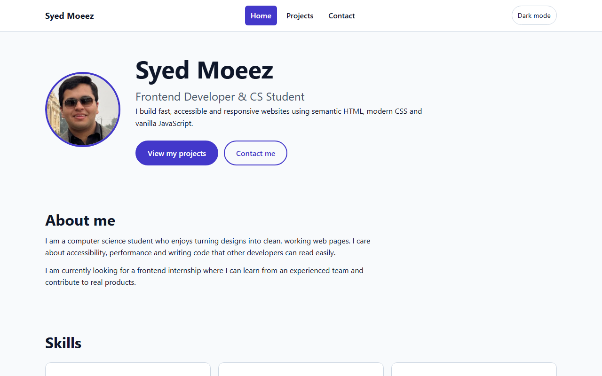

# Responsive Developer Portfolio

CS-554 Advanced Web Technologies – Assignment 1 (Version A)

A three-page, mobile-first developer portfolio built with **semantic HTML5, hand-written CSS3 and vanilla JavaScript** (no frameworks or libraries).

**Live site:** https://YOUR-USERNAME.github.io/YOUR-REPO-NAME/



## Pages

| Page | Contents |
| --- | --- |
| `index.html` | Hero with name, role and call-to-action, About me, Skills, footer links |
| `projects.html` | Project cards rendered by JavaScript from an array, with combined search + technology filter, live result count, empty state and a `<dialog>` detail modal |
| `contact.html` | Contact form with JavaScript validation and per-field error messages |

## Features

- One shared stylesheet (`css/style.css`) starting with a `box-sizing: border-box` reset
- Flexbox navbar; CSS Grid project cards (1 → 2 columns at 640px → 3 columns at 1024px)
- Colours, radius and spacing as CSS custom properties in `:root`
- Dark theme via `prefers-color-scheme` **and** a manual toggle (`data-theme` on `<html>`), saved in `localStorage`
- Visible `:focus-visible` styles, fluid headings with `clamp()`, skip link
- Animations only run when `prefers-reduced-motion` allows it

## Project structure

```
├── index.html
├── projects.html
├── contact.html
├── css/style.css
├── js/theme.js      # dark mode toggle (all pages)
├── js/projects.js   # project data, rendering, search/filter, modal
├── js/contact.js    # form validation
└── images/profile.jpg
```

## Run locally

Open `index.html` in a browser, or use the VS Code **Live Server** extension.
